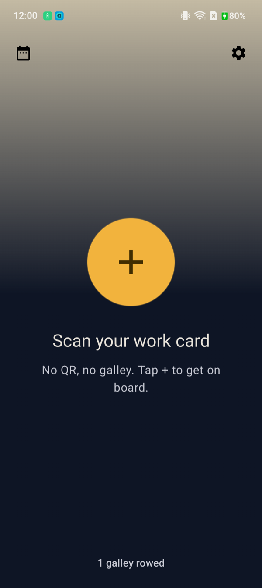
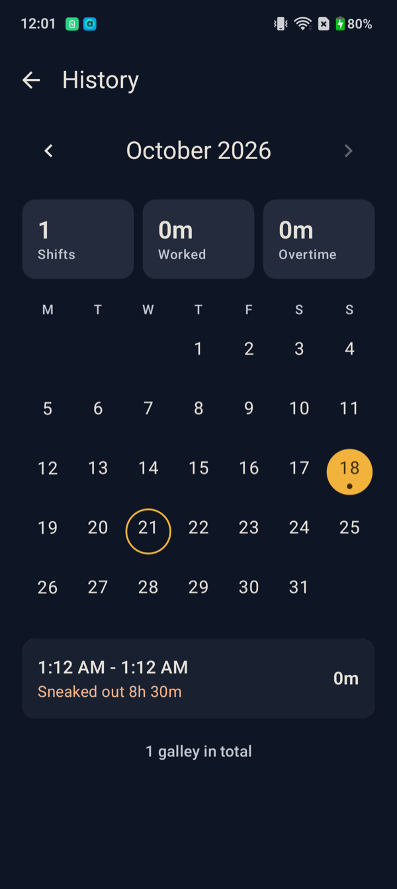
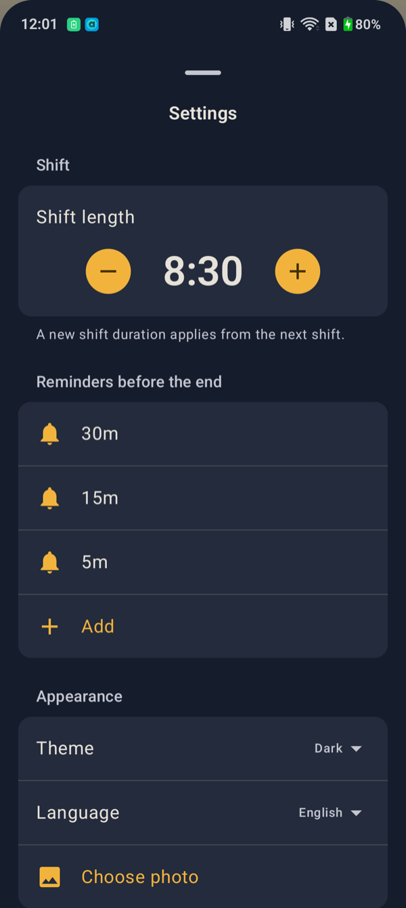
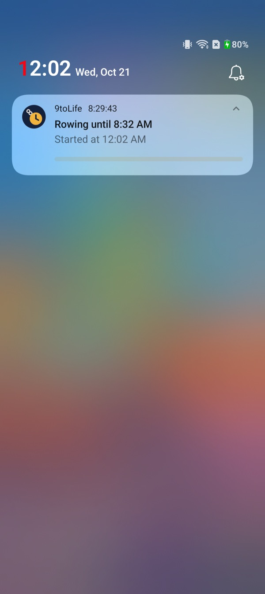
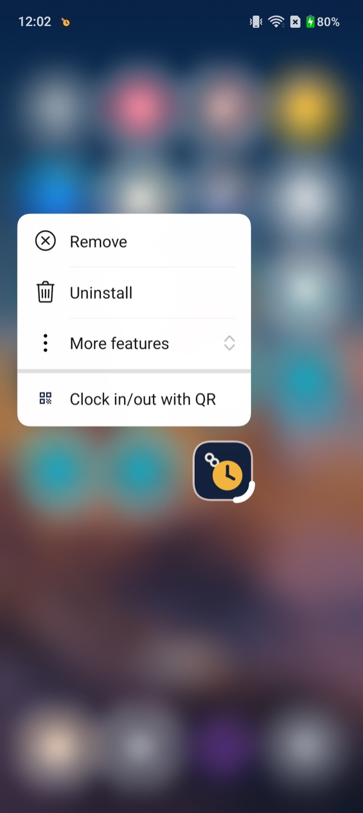
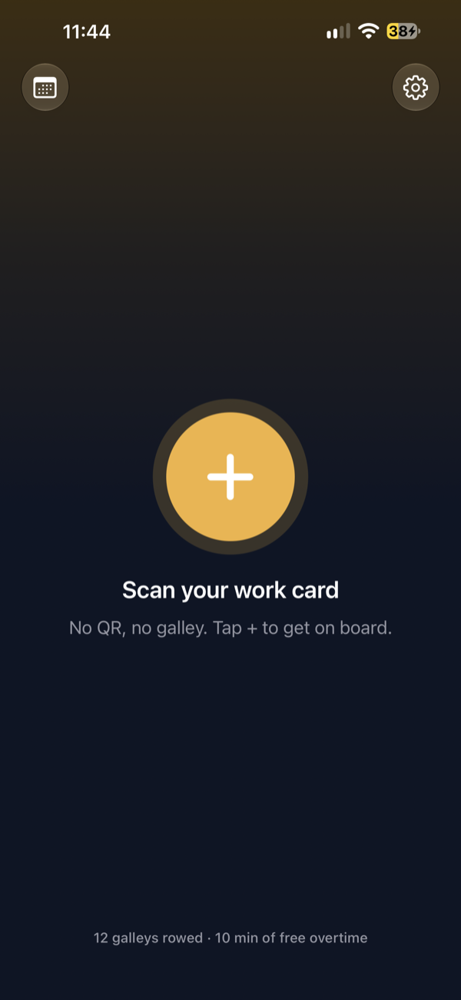
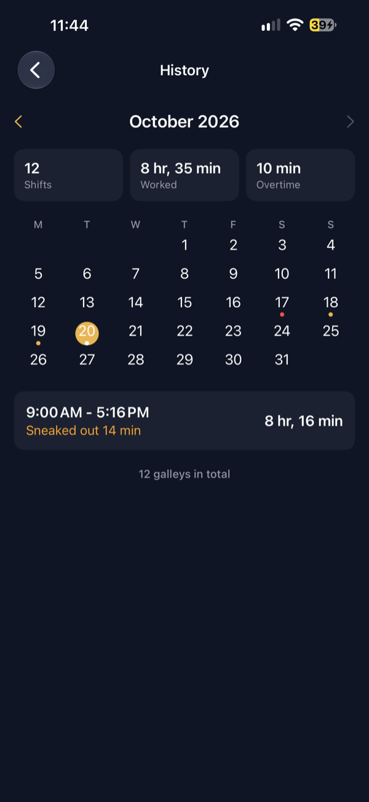
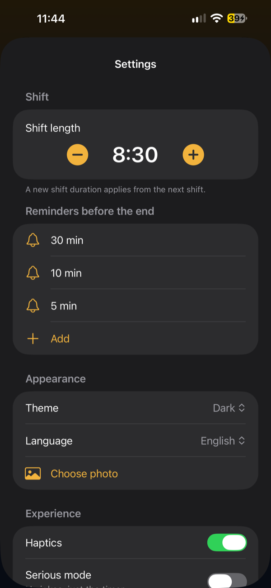
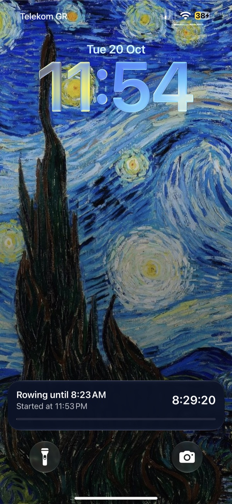
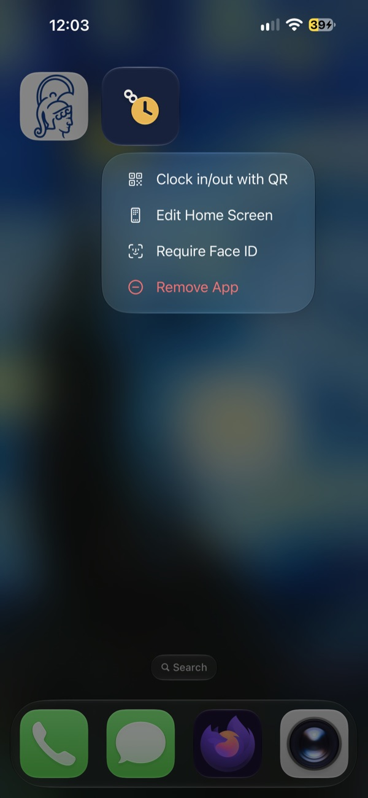

# 9toLife

A satirical (but honest) shift timer built around the QR of the Greek digital work card (Ergani).
In Greece, many employees clock in and out by scanning a personal QR code at the workplace, and the employer reports the times to the ERGANI system.
Scan the card once; from then on, opening the QR at the door is the clock-in or clock-out, with undo.
The app counts down the shift, keeps it visible outside the app, and keeps a history of past shifts.

Kotlin Multiplatform: shared logic, native UI on each platform (Jetpack Compose on Android, SwiftUI on iOS).

## Features

- **Clock in / out with the QR**: tapping the QR opens it full screen at max brightness and starts or ends the shift. Undo is offered for a few seconds.
- **Live timer**: countdown on Home, then overtime. Outside the app, an ongoing notification (Android) or a Live Activity on the Lock Screen and Dynamic Island (iOS).
- **Reminders**: before the planned end (configurable), at the end, and a "forgot to clock out?" nudge 10 minutes after it.
- **Quick QR**: open the QR without opening the app first. Quick Settings tile and launcher shortcut on Android; Control Center / Lock Screen control and Home Screen quick action on iOS.
- **History**: month calendar, monthly stats, overtime and early leave ("Κοπάνα") per shift, swipe to delete with undo.
- **Settings**: shift duration, reminders, theme, language (Greek / English), haptics, background photo, and a serious mode that drops the jokes.

## Screenshots

| | Home | History | Settings | Outside the app | Quick QR |
|---|---|---|---|---|---|
| **Android** |  |  |  |  |  |
| **iOS** |  |  |  |  |  |

## Project structure

| Module | What lives there |
|---|---|
| [`sharedLogic`](./sharedLogic/src) | Domain models, use cases, repositories (DataStore for settings and the running shift, Room for finished shifts), shared MVI ViewModels, Koin modules. |
| [`androidApp`](./androidApp/src/main) | Compose UI with Navigation 3, notifications, alarms, Quick Settings tile. |
| [`iosApp/iosApp`](./iosApp/iosApp) | SwiftUI app. |
| [`iosApp/ShiftWidget`](./iosApp/ShiftWidget) | Widget extension: the Live Activity and the quick QR control. |

### Tech stack

- **Shared**: Kotlin Multiplatform, Coroutines, kotlinx-datetime, Koin, DataStore, Room KMP (bundled SQLite), SKIE.
- **Android**: Jetpack Compose with Material 3, Navigation 3, CameraX with ML Kit barcode scanning, QRose for drawing the QR.
- **iOS**: SwiftUI, AVFoundation for scanning, ActivityKit and WidgetKit for the Live Activity and the control, App Intents.

### Architecture

- Layers: `ui` → `usecase` → `domain` ← `data`. ViewModels talk only to use cases.
- MVI: each screen has a `UiState` (`StateFlow`), one-off events (`Channel`), and one function per user action.
- The ViewModels are shared. Android uses them through Koin; iOS wraps each one in an `@Observable` `XModel` (SKIE bridges `Flow` and sealed types) and releases it through `IosViewModelOwner`.
- iOS screens get their model from `ModelHost`, so each one is created once and not on every parent pass. `appEnvironment(_:)` applies language and haptics at the root and again inside sheets and full-screen covers. `WindowAppearance` applies the theme on the windows.
- Platform work behind interfaces: `ShiftAlerts` (notifications, Live Activity, alarms) is implemented natively and injected.

## Build and run

Requirements: a recent Android Studio, Xcode 26 or later (iOS 26 SDK), JDK 21 for Gradle (provisioned automatically).

- **Android**: run the `androidApp` configuration, or `./gradlew :androidApp:assembleDebug`. minSdk 26.
- **iOS**: open [`iosApp/iosApp.xcodeproj`](./iosApp/iosApp.xcodeproj) (the project, not the repository folder) and run the `iosApp` scheme. The shared framework is built by a Gradle build phase. iOS 18.2 or later.
  - Running on a device needs signing: create `iosApp/Configuration/Local.xcconfig` (git-ignored) with `DEVELOPMENT_TEAM = <your team id>`. To make the bundle id unique, also set `TEAM_ID` in [`Config.xcconfig`](./iosApp/Configuration/Config.xcconfig).

## Development notes

- **Short shifts for testing**: shift duration comes from the settings (15-minute steps). To try the end of a shift quickly, temporarily change `plannedMinutes` in `StartShiftUseCase`.
- **Navigation 3 caches entries (Android)**: an entry's content stays cached until the back stack changes, so screens read changing state through lambdas, not captured values.
- **Theme on iOS**: set with `overrideUserInterfaceStyle` on the windows, because `preferredColorScheme(nil)` does not update sheets that are already open.
- **Background photo on iOS**: only the file name is stored; the app container path changes across installs.
- **Notification channels (Android)**: a channel's sound and vibration cannot change after it is created; changing them needs a new channel id.
- **String catalogs (iOS)**: `Localizable.xcstrings` lives in each target (app and widget); the widget cannot read the app's strings.

## Disclaimer

Not affiliated with ERGANI or the Greek Ministry of Labour. The app only shows the QR you already have; it does not clock you in anywhere by itself, and its own code makes no network requests. On Android, QR scanning uses Google ML Kit, which may send anonymous usage metrics to Google.

## License

[MIT](./LICENSE) © 2026 George Karanikolas
